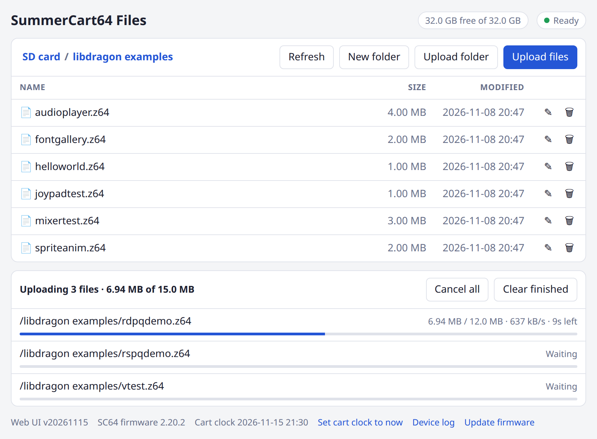
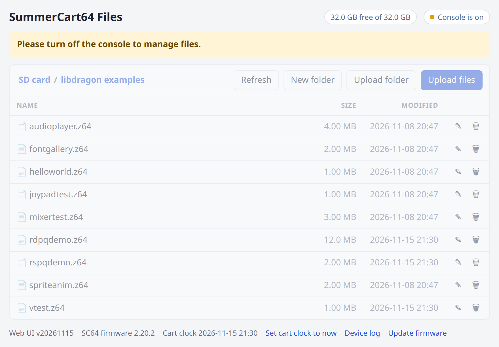

# SummerCart64 Web UI

Manage the SD card in a [SummerCart64](https://github.com/Polprzewodnikowy/SummerCart64)
from a web browser, without taking the card out.

A Raspberry Pi Pico 2 W or Pico W plugs into the cart's USB-C port. It talks to
the cart as a USB host and serves a file manager over Wi-Fi: browse, upload,
download, rename and delete. The SC64 firmware and N64FlashcartMenu are
unmodified.



For now, files can only be managed while the console is off. Transfers go
through the cart's save memory, as with `sc64deployer`, so with the console on
the page asks you to turn it off. The card is handed back as soon as the
console is switched on. Transfers while the console sits in the menu may become
possible in future, with support from N64FlashcartMenu.



## Hardware

The Pico connects through a micro-USB OTG Y cable, the kind sold for Fire TV
Sticks ([example](https://www.amazon.co.uk/dp/B0F7QPGGZW)). It has three ends:

- micro-USB plug: into the Pico
- USB-A socket: to the SC64's USB-C port, with an ordinary USB-A to USB-C cable
- micro-USB socket: to a USB power supply

The power supply feeds both the Pico and the cart, so the cart stays powered
with the console off. The Pico cannot power the cart by itself.

## Install

Download the `.uf2` for your board from the
[releases](https://github.com/dmrlawson/sc64_webui/releases), hold BOOTSEL
while plugging the Pico into a PC, and copy the file onto the drive that
appears.

Later versions can be installed from the page with **Update firmware**. If
power is lost while an update is being installed, reflash with BOOTSEL.

## Wi-Fi

The settings are read at start-up from `/menu/webui/wifi.txt` on the SD card:

```
ssid=My Network
password=my password
```

Without that file the Pico starts its own network, `SC64-WebUI` (password
`summercart64`), with the page at http://192.168.4.1/. Upload the file there
and the Pico restarts and joins your network, where the page is at
http://sc64.local/. To change network later, replace the file and power-cycle
the Pico.

The card cannot be read while the console is on, so a Pico that starts with
the console on also starts its own network, and switches over once the console
is off.

The page has no authentication: anyone who can reach it can read and change
everything on the card, including this file.

## Building

```sh
git submodule update --init
cmake -S . -B build        # add -DPICO_BOARD=pico_w for the Pico W
cmake --build build
```

Requires [pico-sdk](https://github.com/raspberrypi/pico-sdk) 2.2.0 with its
`lib/lwip` and `lib/cyw43-driver` submodules, and an arm-none-eabi toolchain
with newlib.

The device log is at `/api/log` and on the UART (GP0, 115200 baud).

## Simulator

`host/` builds the same code for Linux against a simulated SC64 backed by an SD
card image, for working on the page and file handling without hardware:

```sh
make -C host
truncate -s 300M sd.img && mkfs.exfat sd.img
host/build/sc64webui-sim sd.img 8064        # http://localhost:8064
```

## Licence

GPL-3.0, see [LICENSE](LICENSE). Third-party software is credited in
[ACKNOWLEDGEMENTS.md](ACKNOWLEDGEMENTS.md).
